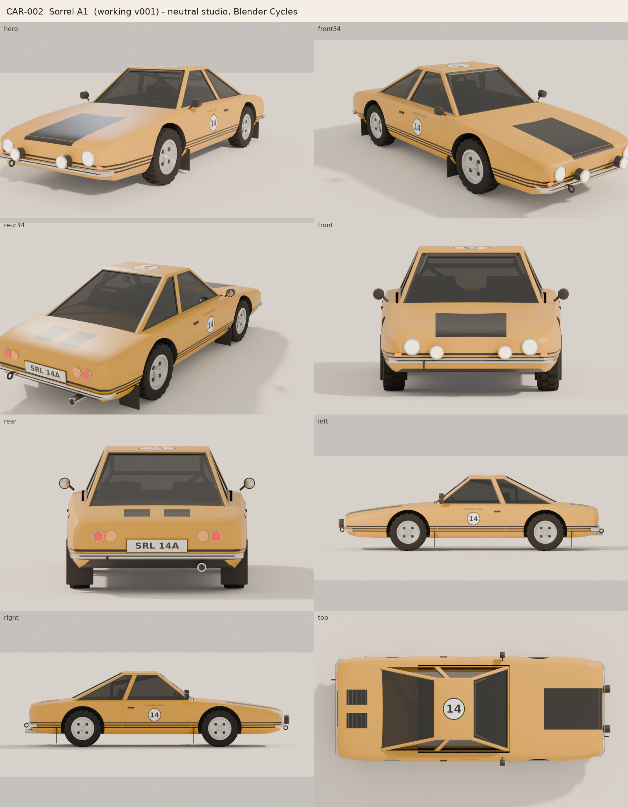
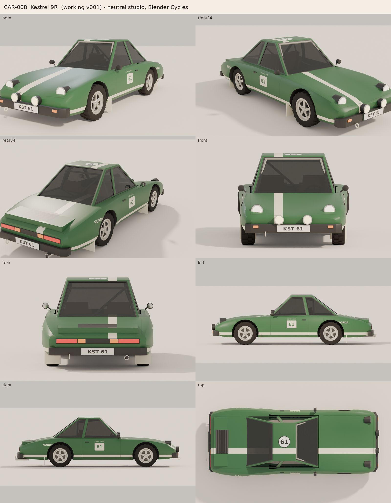
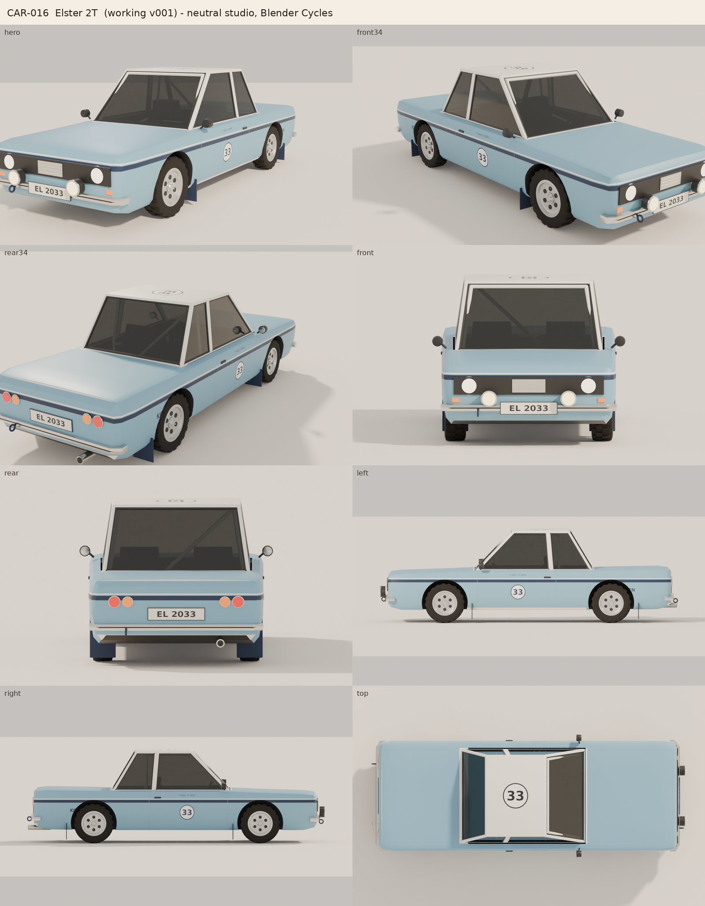
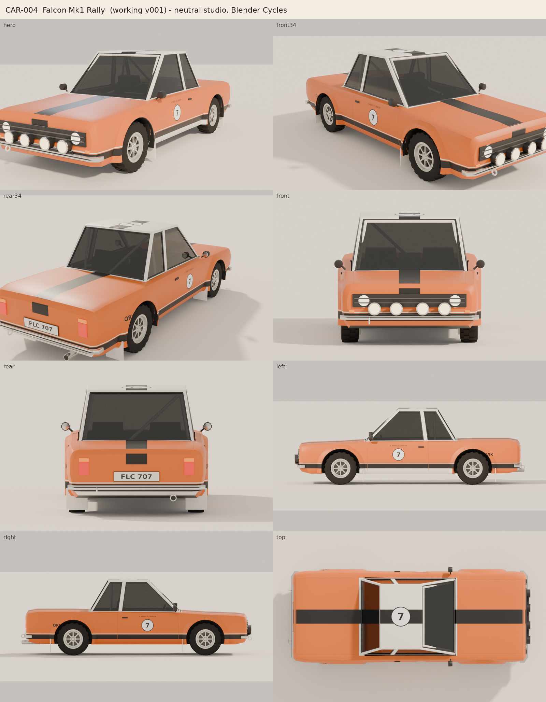
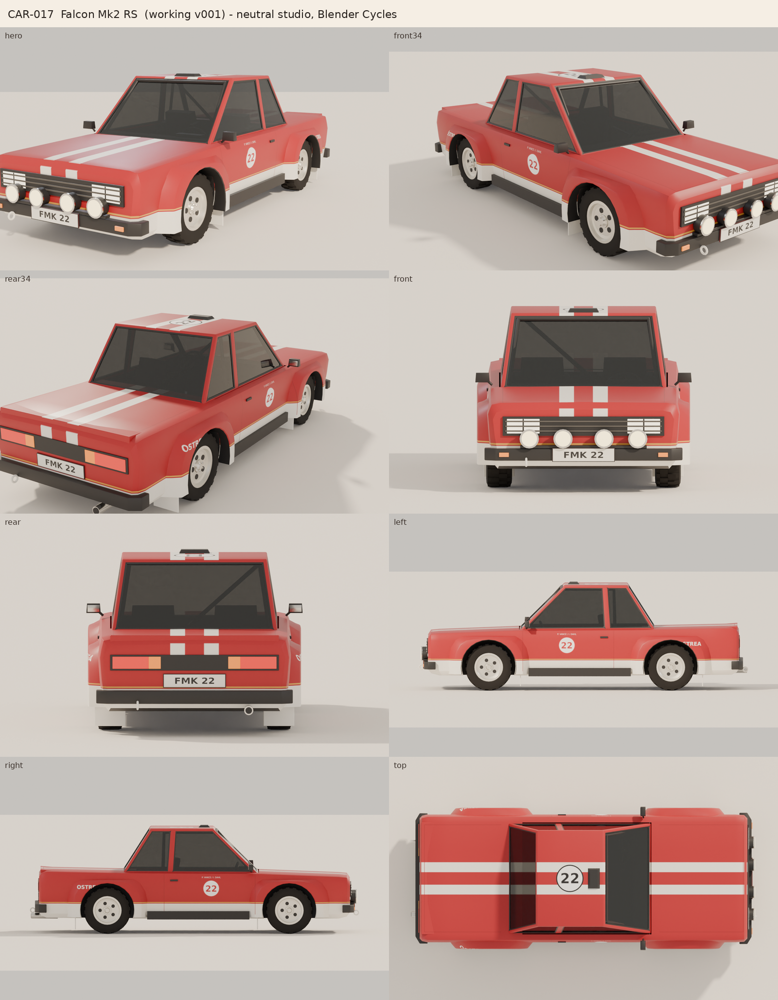
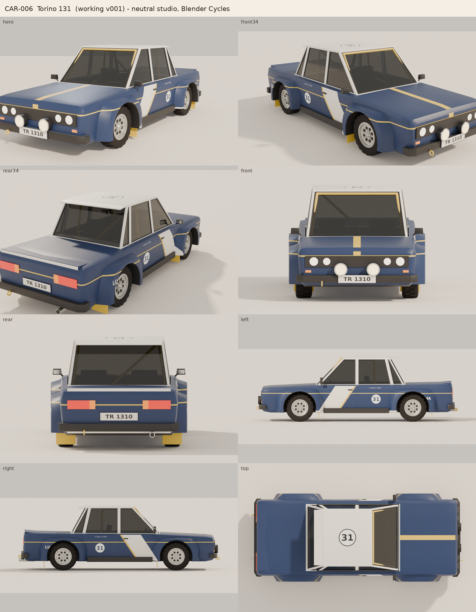
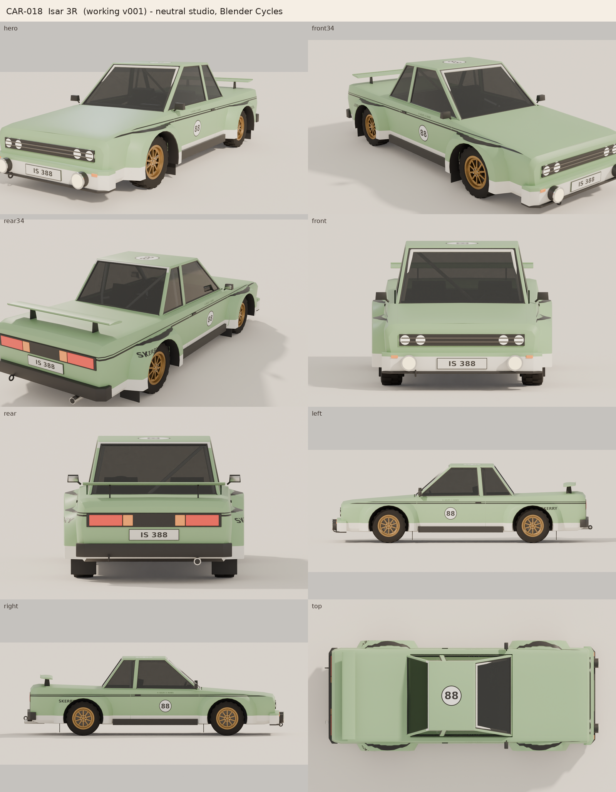
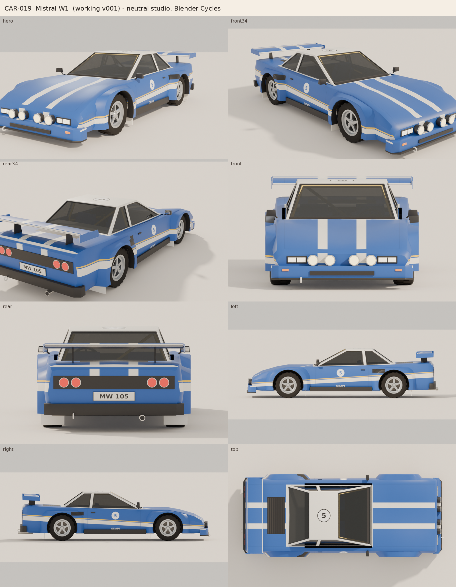

# Reference-image collection: 8 original cars

One original car per screenshot in the supplied `Archive.zip`. Each takes the
reference's general body type, era and proportions. Names, liveries, sponsors and
plates are new and fictional, and no game asset or livery is reproduced. All eight
are built by `cars/build_generic.py` from `cars/collection_specs.py`, painted by
`cars/livery_generic.py`, and checked by the same validation gate as CAR-009.

| ID | Name | Reference class | Size L × W × H (m) | Wheelbase | Tris | Validation |
| --- | --- | --- | --- | --- | --- | --- |
| CAR-002 | Sorrel A1 | small 1960s-70s rear-engine fastback coupe | 4.08 × 1.67 × 1.13 | 2.10 m | 23556 | **PASS** (46/46) |
| CAR-008 | Kestrel 9R | 1970s rear-engine coupe with raised front wings and round lamps | 4.40 × 1.72 × 1.30 | 2.27 m | 21110 | **PASS** (46/46) |
| CAR-016 | Elster 2T | late-1960s/70s boxy two-door saloon with a tall glasshouse | 4.49 × 1.75 × 1.38 | 2.50 m | 23986 | **PASS** (46/46) |
| CAR-004 | Falcon Mk1 Rally | early-1970s two-door saloon with a kicked-up rear hip and quad lamps | 4.20 × 1.72 × 1.36 | 2.40 m | 23008 | **PASS** (46/46) |
| CAR-017 | Falcon Mk2 RS | late-1970s square-cut two-door saloon with rectangular lamps | 4.35 × 1.80 × 1.41 | 2.40 m | 23706 | **PASS** (46/46) |
| CAR-006 | Torino 131 | late-1970s boxy four-door saloon with flared arches | 4.45 × 1.85 × 1.40 | 2.49 m | 25028 | **PASS** (46/46) |
| CAR-018 | Isar 3R | mid-1980s wedge-profile two-door saloon with box arches and a trunk wing | 4.64 × 1.87 × 1.37 | 2.56 m | 23270 | **PASS** (46/46) |
| CAR-019 | Mistral W1 | late-1970s mid-engine wedge coupe with a big rear wing | 4.68 × 1.91 × 1.17 | 2.56 m | 23160 | **PASS** (46/46) |

Width includes mirrors. Each car has 26 objects in the standard hierarchy (`<CAR>_Root`,
Body, Exterior group, Glass, Interior with steering wheel, Lights, and four wheel pivots
with separate tyre and rim), one 2K livery texture, and collision boxes in their own
collection.

## CAR-002: Sorrel A1



* **Reference class:** 0DC8D04C: small 1960s-70s rear-engine fastback coupe
* **Class / drivetrain:** Classic RWD / RWD
* **Wheels:** Ø 0.58 m × 0.190 m, track 1.31 m, dish rims (4) in `#C3C5C6`
* **Flares:** none (plain arches) · **Spoiler:** none
* **Livery (original):** base `#D99A0E`, race number 14, plate "SRL 14A"
* **Files:** `ArtPipeline/VehicleLibrary/CAR-002/Working/CAR-002_Working_v001.blend`, `Export/CAR-002_Export.fbx`, `Export/CAR-002_BaseColor.png`, `Export/CAR-002_vehicle_data.json`

## CAR-008: Kestrel 9R



* **Reference class:** 5AA638FD: 1970s rear-engine coupe with raised front wings and round lamps
* **Class / drivetrain:** Classic RWD / RWD
* **Wheels:** Ø 0.62 m × 0.210 m, track 1.40 m, spoke rims (5) in `#CFCBC2`
* **Flares:** none (plain arches) · **Spoiler:** ducktail
* **Livery (original):** base `#2F5D3A`, race number 61, plate "KST 61"
* **Files:** `ArtPipeline/VehicleLibrary/CAR-008/Working/CAR-008_Working_v001.blend`, `Export/CAR-008_Export.fbx`, `Export/CAR-008_BaseColor.png`, `Export/CAR-008_vehicle_data.json`

## CAR-016: Elster 2T



* **Reference class:** 340BF769: late-1960s/70s boxy two-door saloon with a tall glasshouse
* **Class / drivetrain:** Classic RWD / RWD
* **Wheels:** Ø 0.60 m × 0.195 m, track 1.33 m, dish rims (6) in `#C9CBCB`
* **Flares:** none (plain arches) · **Spoiler:** none
* **Livery (original):** base `#77A8C4`, roof `#F2EFE7`, race number 33, plate "EL 2033"
* **Files:** `ArtPipeline/VehicleLibrary/CAR-016/Working/CAR-016_Working_v001.blend`, `Export/CAR-016_Export.fbx`, `Export/CAR-016_BaseColor.png`, `Export/CAR-016_vehicle_data.json`

## CAR-004: Falcon Mk1 Rally



* **Reference class:** A1B24F84: early-1970s two-door saloon with a kicked-up rear hip and quad lamps
* **Class / drivetrain:** Classic RWD / RWD
* **Wheels:** Ø 0.60 m × 0.205 m, track 1.36 m, spoke rims (8) in `#D6D3CB`
* **Flares:** round · **Spoiler:** none
* **Livery (original):** base `#D9661A`, roof `#F2EFE7`, race number 7, plate "FLC 707"
* **Files:** `ArtPipeline/VehicleLibrary/CAR-004/Working/CAR-004_Working_v001.blend`, `Export/CAR-004_Export.fbx`, `Export/CAR-004_BaseColor.png`, `Export/CAR-004_vehicle_data.json`

## CAR-017: Falcon Mk2 RS



* **Reference class:** A3A1E2BD: late-1970s square-cut two-door saloon with rectangular lamps
* **Class / drivetrain:** Group 4 / RWD
* **Wheels:** Ø 0.62 m × 0.215 m, track 1.40 m, dish rims (5) in `#E8E4DA`
* **Flares:** box · **Spoiler:** lip
* **Livery (original):** base `#A81E28`, race number 22, plate "FMK 22"
* **Files:** `ArtPipeline/VehicleLibrary/CAR-017/Working/CAR-017_Working_v001.blend`, `Export/CAR-017_Export.fbx`, `Export/CAR-017_BaseColor.png`, `Export/CAR-017_vehicle_data.json`

## CAR-006: Torino 131



* **Reference class:** E42282C2: late-1970s boxy four-door saloon with flared arches
* **Class / drivetrain:** Group 4 / RWD
* **Wheels:** Ø 0.62 m × 0.225 m, track 1.44 m, dish rims (8) in `#C4C4C0`
* **Flares:** box · **Spoiler:** lip + roof spoiler
* **Livery (original):** base `#24345A`, roof `#F2EFE7`, race number 31, plate "TR 1310"
* **Files:** `ArtPipeline/VehicleLibrary/CAR-006/Working/CAR-006_Working_v001.blend`, `Export/CAR-006_Export.fbx`, `Export/CAR-006_BaseColor.png`, `Export/CAR-006_vehicle_data.json`

## CAR-018: Isar 3R



* **Reference class:** 8313D565: mid-1980s wedge-profile two-door saloon with box arches and a trunk wing
* **Class / drivetrain:** Group B / RWD
* **Wheels:** Ø 0.62 m × 0.225 m, track 1.46 m, spoke rims (10) in `#9C7B4A`
* **Flares:** box · **Spoiler:** wing
* **Livery (original):** base `#8DB583`, race number 88, plate "IS 388"
* **Files:** `ArtPipeline/VehicleLibrary/CAR-018/Working/CAR-018_Working_v001.blend`, `Export/CAR-018_Export.fbx`, `Export/CAR-018_BaseColor.png`, `Export/CAR-018_vehicle_data.json`

## CAR-019: Mistral W1



* **Reference class:** 12F0EF7C: late-1970s mid-engine wedge coupe with a big rear wing
* **Class / drivetrain:** Group B / RWD
* **Wheels:** Ø 0.64 m × 0.255 m, track 1.52 m, spoke rims (5) in `#BFC3C7`
* **Flares:** box · **Spoiler:** wing
* **Livery (original):** base `#2856A8`, roof `#F2EFE7`, race number 5, plate "MW 105"
* **Files:** `ArtPipeline/VehicleLibrary/CAR-019/Working/CAR-019_Working_v001.blend`, `Export/CAR-019_Export.fbx`, `Export/CAR-019_BaseColor.png`, `Export/CAR-019_vehicle_data.json`

## Rebuild

```bash
cd ArtPipeline/Blender/Scripts
```

```bash
BLENDER=/Applications/Blender.app/Contents/MacOS/Blender ./run_car_pipeline.sh all
```

Not done yet: Unity import and Play Mode test (see `BLENDER_TO_UNITY.md`), and your art review.
