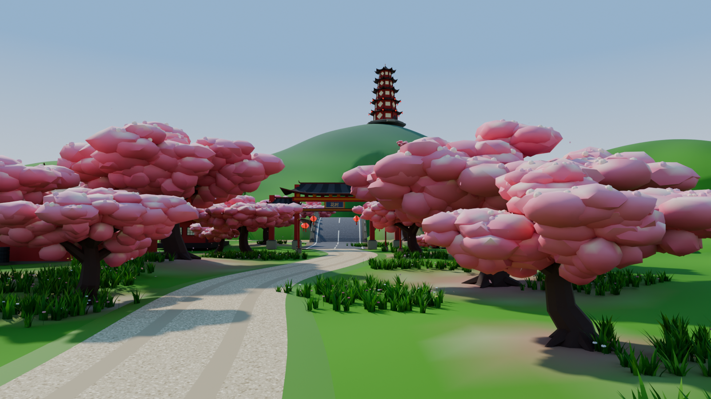
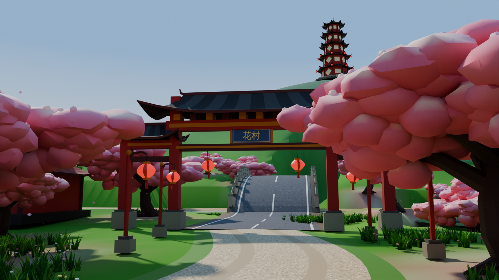
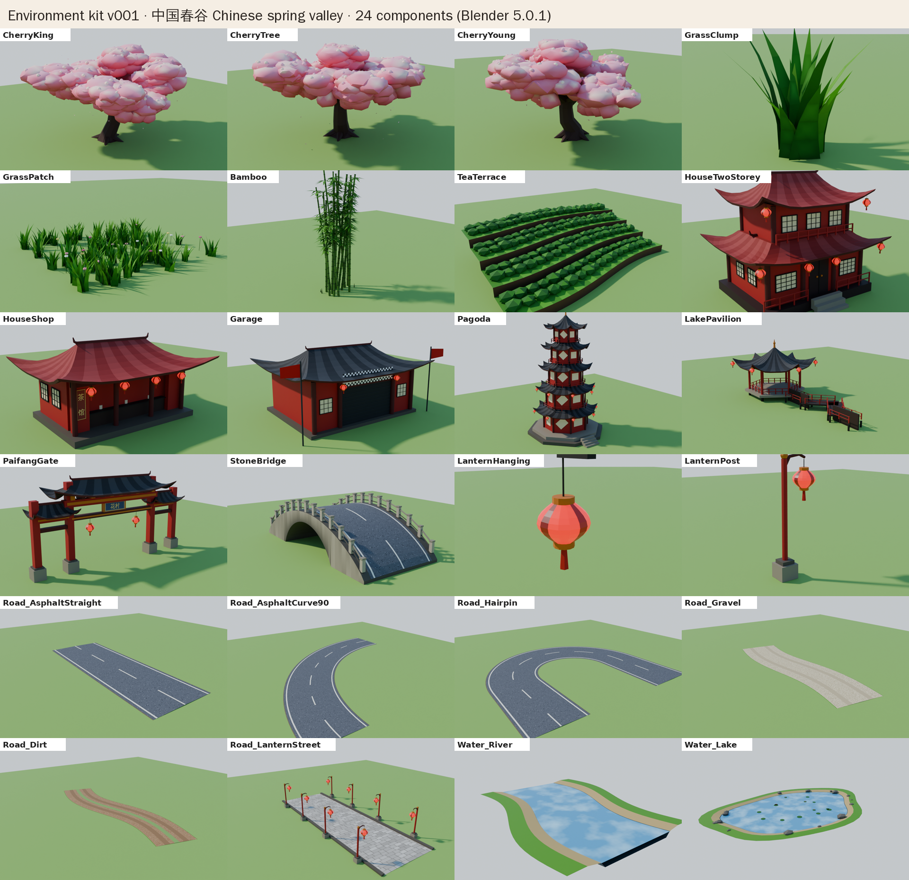

# Environment kit v001: Chinese spring valley

Everything here was built and rendered by running the scripts in **Blender 5.0.1**
(Cycles, CPU). The plan and art direction are in
[`ENVIRONMENT_KIT_PLAN.md`](ENVIRONMENT_KIT_PLAN.md).




Animated loops (4 s, seamless): `ArtPipeline/EnvironmentLibrary/Previews/Animation/`
(`ENV_Diorama_Loop`, `ENV_GateCloseup_Loop`, `ENV_CherryKing_Loop`, each as `.gif` and `.mp4`).

All components: 

## Components

| Component | What it is | Motion |
| --- | --- | --- |
| `ENV_CherryKing` | Landmark cherry blossom tree, about 9.5 m, 8 limbs | Each limb sways on its own pivot; 40 falling petals |
| `ENV_CherryTree` | Standard cherry tree, about 6.5 m | Limb sway, petals |
| `ENV_CherryYoung` | Young cherry tree, about 4.2 m | Limb sway, petals |
| `ENV_GrassClump` / `ENV_GrassPatch` | Broad two-tone blades; 4 × 4 m meadow patch with wildflowers | `Wind` blend shape on a loop |
| `ENV_Bamboo` | 16-stalk bamboo grove with leaf sprays | Every stalk sways from its base |
| `ENV_TeaTerrace` | 4-step curved tea terrace with bush rows | Gentle `Wind` blend shape |
| `ENV_HouseTwoStorey` | Two-storey village house (from your reference): double sweeping red roofs, lattice windows, balcony, veranda | 6 swinging lanterns |
| `ENV_HouseShop` | Teahouse with open counter and a 茶馆 sign | 4 lanterns |
| `ENV_Garage` | Start garage with roller door, START 起点 banner and tyre stacks | 2 waving flags, 2 lanterns |
| `ENV_Pagoda` | Five-tier octagonal pagoda: stone plinth, balconies, gold finial | 16 swinging eave lanterns |
| `ENV_LakePavilion` | Hexagonal pavilion on stilts with a zig-zag walkway | 6 lanterns |
| `ENV_PaifangGate` | Three-bay paifang with 8 m road clearance and a 花村 ("Blossom Village") plaque | 2 lanterns |
| `ENV_StoneBridge` | 18 m arched stone bridge (22 m in the diorama) with parapets and an asphalt deck | none |
| `ENV_LanternHanging` / `ENV_LanternPost` | Red lantern with gold caps and tassel; street lantern post | Swing; emissive glow |
| `ENV_Road_AsphaltStraight` / `_AsphaltCurve90` / `_Hairpin` | 7 m asphalt with edge lines, dashed centre line and shoulders (main loop, pagoda hairpins) | none |
| `ENV_Road_Gravel` / `_Dirt` | Terrace climb gravel / bamboo-run dirt | none |
| `ENV_Road_LanternStreet` | Stone paving with curbs and 8 lantern posts (Lantern Street) | Lanterns swing |
| `ENV_Water_River` / `ENV_Water_Lake` | River segment with banks; lake with shore rocks, lotus pads and flowers | Water ripple (material) |

Triangle counts and sizes: `ArtPipeline/Blender/Reports/ENV_Kit_build.json`.
FBX checks: `ArtPipeline/Blender/Reports/ENV_Kit_export.json`.

## Files

* `ArtPipeline/EnvironmentLibrary/Working/ENV_Kit_v001.blend`: the editable library. Every component sits
  in its own collection `ENV_<Name>`, with `<Name>_Root` on the ground at its base.
* `ArtPipeline/EnvironmentLibrary/Working/ENV_Diorama_v001.blend`: the diorama scene, with cameras
  `Diorama_Cam` and `Closeup_Cam`.
* `ArtPipeline/EnvironmentLibrary/Export/ENV_*.fbx`: one FBX per component, with animation, plus the
  sign and road textures.
* `ArtPipeline/EnvironmentLibrary/Textures/`: generated sign and road textures.

## Unity notes

* **Axes:** same contract as the cars (+Z forward, +Y up in Unity, metres). Building fronts face Unity −Z.
* **Animation:** each FBX holds one 96-frame take (4 s). Set the clip to *Loop Time* in the Animation
  import tab. Sway is transform animation on pivot objects; grass and tea use the `Wind` blend shape.
* **Many copies** (the meadows and the forest): use a wind vertex shader instead of animated clips.
  The `Col` vertex colour holds the colour, and its **alpha is a wind weight** (0 at the base, 1 at the
  tips/canopy).
* **Materials:** almost everything uses one vertex-colour material (`M_Env_VertexColor`). In URP,
  use a Shader Graph that reads vertex colour, with double-sided rendering for grass, bamboo leaves,
  petals and flags. Lanterns use `M_Env_LanternGlow` (emissive). Water needs a URP water shader; the
  Blender preview animates a noise texture. Roads and signs use small textures.
* **Petals:** keyframed meshes in the preview. In the game, use a particle system with the
  `ENV_PetalMesh` mesh.

## Rebuild

```bash
cd ArtPipeline/Blender/Scripts/environment
```

```bash
python3 env_textures.py --out-dir ../../../EnvironmentLibrary/Textures
```

```bash
blender -b -P build_environment_kit.py -- --out ../../../EnvironmentLibrary/Working/ENV_Kit_v001.blend --report ../../Reports/ENV_Kit_build.json
```

```bash
blender -b -P build_diorama.py -- --out ../../../EnvironmentLibrary/Working/ENV_Diorama_v001.blend
```

```bash
blender -b -P export_env_fbx.py -- --blend ../../../EnvironmentLibrary/Working/ENV_Kit_v001.blend --out-dir ../../../EnvironmentLibrary/Export --report ../../Reports/ENV_Kit_export.json
```

Not done yet: the full 1 km valley layout from the map blueprint (next step, after your approval),
LODs, the Unity shaders, and in-engine tests.
