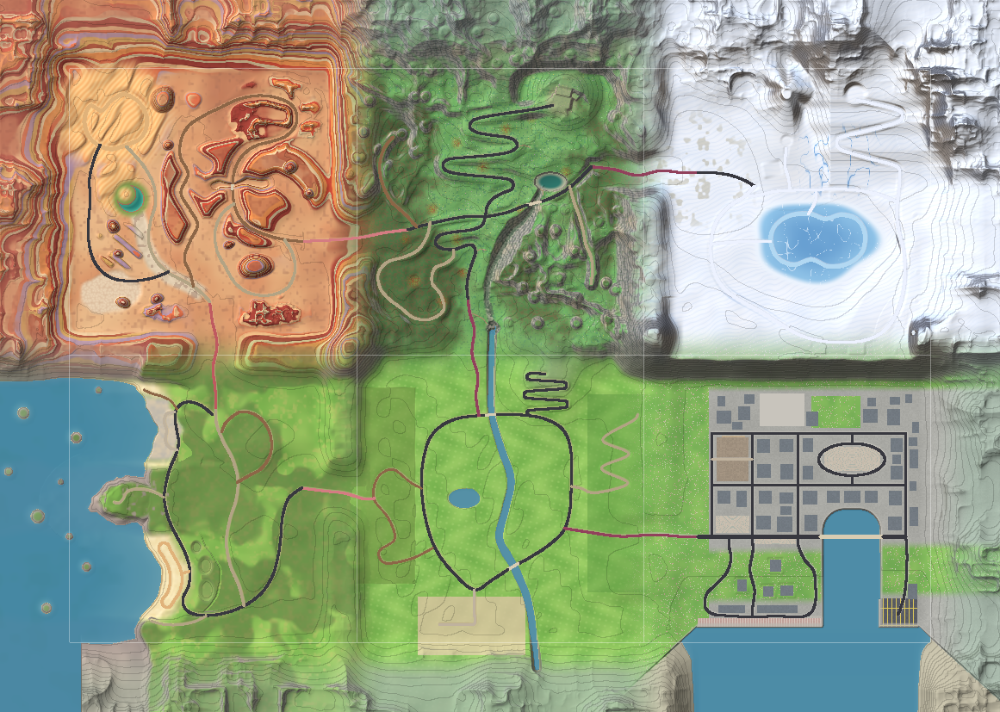

# Blossom Rally open world (0.10.0)

Six regions of 1 km each in a 3 × 2 km grid. Six cross-border roads link them through low mountain passes.

| Region | Tile (x, z) | Highlights | Stages |
|---|---|---|---|
| **Blossom Valley** 花谷 | -500..500, -500..500 | The original valley, unchanged | Valley Loop, Pagoda Climb, Tea Terrace Sprint, Bamboo Run, Pagoda Drift Zone |
| **Jade Harbour City** 港城 | 500..1500, -500..500 | 54 towers up to 222 m, the 254 m Lantern Tower, neon, Old Town pagoda, a drivable cable-stayed harbour bridge, container port | Harbour Street Sprint, Neon Night Drift |
| **Lotus Coast** 莲岸 | -1500..-500, -500..500 | Open sea to the horizon, beaches and dunes, lighthouse headland, stilt fishing harbour, karst islets | Lotus Coast Road, Sunset Beach Drift |
| **Cloud Peak Mountains** 云峰 | -500..500, 500..1500 | Granite pillars, about 2,600 pines, a cloud sea, a hilltop monastery, cable car, jade lake, the falls where the valley river begins | Cloud Peak Hillclimb, Monastery Hairpins, Pine Forest Gravel |
| **Frost Summit** 雪顶 | 500..1500, 500..1500 | Snow plateau, frozen-lake ice circuit, ski lodge, cable car, wind turbines, observatory, cliff viewpoints over the city, snowfall and blizzards | Frost Summit Run, Frozen Lake Ice Drift |
| **Red Canyon** 丹霞 | -1500..-500, 500..1500 | Rainbow rock bands, mesas, a slot canyon, dunes, oasis, Silk Road watchtower and caravanserai, dust devils, heat haze | Danxia Dust Run, Dune Drift, Canyon Wash Gravel |

**Playing**
- Free Roam starts at the valley garage.
- **Pause → Fast travel** (←/→ to pick a region, Enter to go) puts the car on a road in any region.
- The event map is now a world map with region names.
- A banner appears each time you enter a region.
- New surfaces: **Snow**, **Ice** (very low grip) and **Sand**, each with its own grip, dust and rumble.
- Rain turns to snow on the summit and stays away from the desert, and the ambience changes from region to region.

**How it works (code)**
- `Scripts/World/Regions/WorldLayout.cs` holds the grid, blend weights, gateways, connector roads, border ridges and rim.
- `Scripts/WorldField.cs` is the pure height, road and ground logic. It blends the regions, adds ridges and rim, smooths the pass corridors, and handles pads and road cut/fill.
- `Scripts/World/Regions/<Region>/` holds each region. Plain files are pure terrain and roads; `*.Build.cs` files build the content.
- `RegionRuntime` loads each region's content when the camera is within 720 m of it. Tall landmarks (the skyline) are always visible.
- `Tools/TerrainHarness` is an offline renderer and road checker that runs the real terrain code outside Unity. See its README.

**Performance notes**
- Each region holds about 0.4–0.77M merged static triangles. Only the regions near the camera are active.
- The terrain is 234 chunks of 200 m with a 4 m grid.
- Loading takes longer than in 0.9 because the world is six times bigger. Expect roughly 10–20 s more on an M1.
