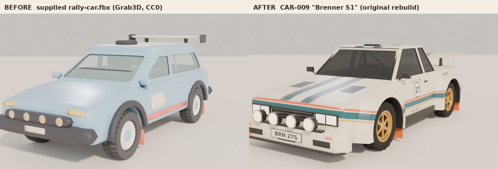
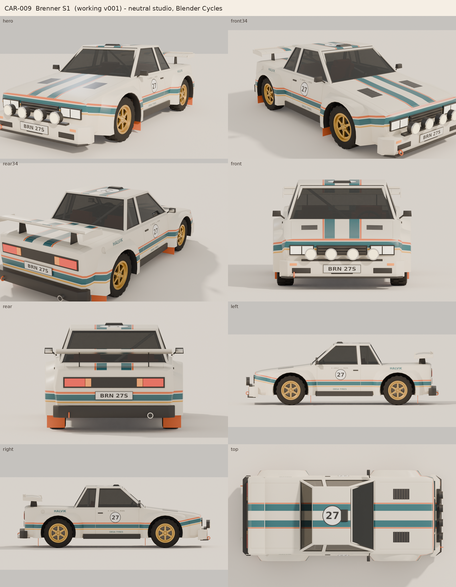
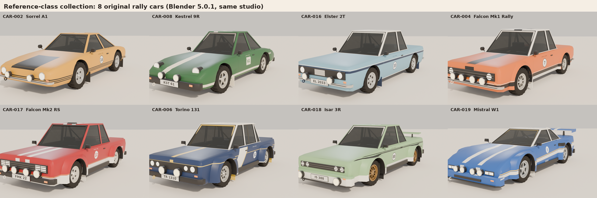

# Rally Game: stylised car collection (Blender → Unity)

Original, stylised low-poly rally cars for a macOS-first Unity (URP) rally game.
Everything is built and checked by reusable **Blender Python** scripts, with
**FBX** as the Unity interchange format.



## Status

| Car | State |
| --- | --- |
| **CAR-009 "Brenner S1"** (1980s Group-B-style AWD coupe, original design) | Blender build, previews, FBX export and validation (**PASS 46/46**) done. **Unity import and drive test still to do.** Awaiting your art review. |
| **8 reference-class cars**: CAR-002 Sorrel A1, CAR-008 Kestrel 9R, CAR-016 Elster 2T, CAR-004 Falcon Mk1 Rally, CAR-017 Falcon Mk2 RS, CAR-006 Torino 131, CAR-018 Isar 3R, CAR-019 Mistral W1 | One original car per reference screenshot, all built by the generic spec-driven builder, with FBX exports and validation. See [`Documentation/COLLECTION_REFERENCE_CARS.md`](Documentation/COLLECTION_REFERENCE_CARS.md). Unity test still to do. |
| Remaining roster (CAR-001, 003, 005, 007, 010–015) | Not started |





**CAR-009 at a glance:** 4.26 × 1.92 × 1.37 m · wheelbase 2.36 m · track 1.56 m ·
22,702 tris · one 2K livery texture · 17 shared materials · four wheel pivots at the
axle centres, with separate tyre and rim meshes · interior with roll cage · collision
boxes in their own collection.

## Repository layout

```text
Documentation/
  CAR_ASSET_PIPELINE.md      the production rules (supplied brief)
  ART_DIRECTION.md           reference study, style rules, shared material palette
  BLENDER_TO_UNITY.md        FBX axis contract + exact Unity steps
  CAR_ASSET_TRACKER.md       per-car checklist
LICENSES.md                  license record for every third-party asset
ArtPipeline/
  Incoming/CAR-009/          original download (read-only) + LICENSE.txt + notes
  References/                Art of Rally screenshots - local only, gitignored
  Blender/Scripts/
    inspect_vehicle.py       read-only inspection -> JSON report
    prepare_vehicle.py       normalise a downloaded model (dry run, versioned output)
    export_vehicle_fbx.py    export only the car collection + Unity vehicle data JSON
    validate_vehicle.py      approval gate (structure, pivots, textures, FBX round trip)
    render_previews.py       neutral studio, 8 standard views (same for every car)
    make_contact_sheet.py    tiles the previews (Pillow)
    vehicle_builder.py       reusable geometry/material helpers
    cars/car009_spec.py      CAR-009 design spec (dimensions, atlas layout, palette)
    cars/build_car009.py     builds CAR-009 in Blender
    cars/livery_car009.py    paints the CAR-009 livery atlas (Pillow)
    cars/collection_specs.py compact specs for the 8 reference-class cars
    cars/carspec.py          spec -> sections, glasshouse, atlas (shared, pure Python)
    cars/build_generic.py    builds any car from its spec
    cars/livery_generic.py   paints any car's livery from its spec
    run_car009_pipeline.sh   runs everything above, in order, for CAR-009
    run_car_pipeline.sh      same for any spec'd car (or "all")
    make_collection_doc.py   writes the collection doc from the real reports
  Blender/Reports/           JSON reports from real Blender runs
  VehicleLibrary/CAR-009/
    Source/                  normalised copy of the download (reference)
    Working/                 CAR-009_Working_v001.blend  <- editable master
    Export/                  CAR-009_Export.fbx, texture, CAR-009_vehicle_data.json
    Textures/                CAR-009_BaseColor.png
    Previews/                studio renders + contact sheet
    Documentation/           inspection report, design, plan
UnityProject/Assets/_Game/Scripts/Vehicles/
  VehicleDefinition.cs       ScriptableObject with gameplay stats
  VehicleWheelVisuals.cs     WheelCollider -> visual wheel pivots
  RallyTestDriveController.cs  minimal test driving (legacy input or Input System)
  Editor/VehicleSetupWizard.cs Tools > Rally > Set Up Vehicle From Data
```

## Run the pipeline

You need Blender 5.0+ and Python 3 with Pillow (`pip install pillow`).

```bash
cd ArtPipeline/Blender/Scripts
```

```bash
BLENDER=/Applications/Blender.app/Contents/MacOS/Blender ./run_car009_pipeline.sh
```

Or, with the standalone `bpy` module (`pip install bpy==5.0.1` on Python 3.11):

```bash
BPY_PYTHON=/path/to/venv/bin/python ./run_car009_pipeline.sh
```

For the eight reference-class cars:

```bash
BLENDER=/Applications/Blender.app/Contents/MacOS/Blender ./run_car_pipeline.sh all
```

Each script also runs on its own. For example, to inspect any new download:

```bash
blender -b -P inspect_vehicle.py -- --input ../../Incoming/CAR-001/model.fbx --car-id CAR-001 --out ../Reports/CAR-001_inspection.json
```

## Ground rules (from the brief)

* `Incoming/` is never modified. Scripts refuse to write there and save new `_vNNN`
  versions instead of overwriting.
* No assets are extracted or recreated from *Art of Rally* or any other game. The
  reference screenshots are inspiration only and are not published here.
* No real manufacturer names, badges, sponsor logos or liveries. All names are fictional.
* A car is complete only after its Unity prefab drives correctly in Play Mode.

## How the results were produced

All Blender work in this repository was done by actually running the scripts in
**Blender 5.0.1** (the `bpy` module, Cycles CPU, headless Linux), and the JSON reports
are those runs' output. The Unity C# scripts have **not** been compiled or run yet,
because no Unity installation was available.
